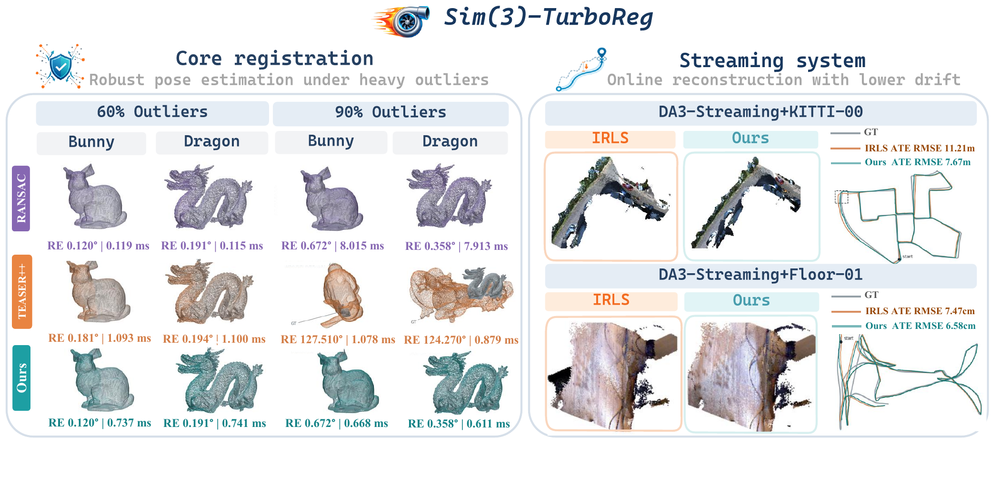
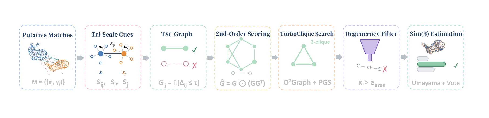

<div align="center">

# Sim(3)-TurboReg

**Robust and Efficient Scale-Aware Registration via Tri-Scale Consistency**

[](https://arxiv.org/abs/2611.14135)
[](LICENSE)

Zijun Zhou\*, Shaocheng Yan\*, Zhenjun Zhao, Yutong Hu, Ke Yang, Yingdong Gu, Pengcheng Shi, Jiayuan Li†

<sup>1</sup> Wuhan University &nbsp;&nbsp; <sup>2</sup> University of Zaragoza &nbsp;&nbsp; (\* equal contribution, † corresponding author)



</div>

Sim(3)-TurboReg registers outlier-contaminated 3D correspondences `src, dst ∈ R^(N×3)` under an unknown scale:

```
y = sRx + t,   s > 0,  R ∈ SO(3)
```

The core method combines local scale voting, a strict **Tri-Scale Consistency (TSC)** graph, and **TurboClique** candidate search. Graph construction, model solving, scoring, refinement, and the RANSAC baseline all run in C++/LibTorch (CPU and CUDA share the same dense-graph algorithm); Python handles data, scheduling, and evaluation. The solver takes **correspondences** as input — feature extraction and matching are provided by the caller.

<div align="center">

</div>

## Highlights

- **Robust at 90% outliers**: matches RANSAC accuracy with **92.5% lower median latency** on controlled unknown-scale registration; TEASER++ diverges at 90% outliers while Sim(3)-TurboReg stays accurate (mean rotation error 0.48°).
- **Better streaming reconstruction**: as a drop-in chunk-alignment backend for DA3-Streaming, improves mean ATE RMSE by **22.2%** and reduces mean end-to-end time by **16.6%** on KITTI.
- **Fast**: millisecond-scale solves on both CPU and GPU through a single dense-graph implementation.

## Results

**Controlled registration (TEASER++ unknown-scale protocol, Bunny, N = 100)** — mean over all trials, latency = median synchronized solve:

| Outlier ratio | Method | Scale err ↓ | Rotation err (deg) ↓ | Translation err ↓ | Latency (ms) ↓ |
|---:|---|---:|---:|---:|---:|
| 60% | TEASER++ | 0.0044 | 0.204 | 0.0073 | **0.89** |
| 60% | **Ours** | **0.0029** | **0.169** | **0.0060** | 3.01 |
| 90% | TEASER++ | 5.9169 | 120.72 | 6.8008 | **0.90** |
| 90% | **Ours** | **0.0075** | **0.483** | **0.0177** | 3.02 |

Across all 16 object × outlier conditions (4 objects), ours has lower mean error on 48/48 condition–metric pairs.

**Streaming 3D reconstruction (ATE RMSE, m)** — Sim(3)-TurboReg as the chunk-alignment backend:

| Method | KITTI Avg ↓ | KITTI Avg\* ↓ | TUM RGB-D Avg ↓ |
|---|---:|---:|---:|
| VGGT-Long | 25.671 | 22.432 | 0.0824 |
| Pi-Long | 29.766 | 15.278 | 0.0808 |
| DA3-Streaming | 24.477 | 16.541 | 0.0492 |
| VGGT-Long + TurboReg | 29.303 | 25.026 | 0.0698 |
| Pi-Long + TurboReg | 28.141 | 15.428 | 0.0682 |
| DA3-Streaming + TurboReg | **19.046** | **13.756** | **0.0437** |

\* excluding Seq 01. Full tables, per-sequence numbers, ablations, and failure analysis are in the [paper](https://arxiv.org/abs/2611.14135).

## Repository layout

- [`turboreg/`](turboreg/) — core C++ library ([headers](turboreg/include/turboreg), [sources](turboreg/src))
- [`apps/`](apps/) — C++ CLI
- [`bindings/`](bindings/) — Python bindings (pybind11 / LibTorch)
- [`registration/`](registration/) — controlled registration experiments (TEASER++ protocol, configs, scripts)
- [`streaming/`](streaming/) — streaming 3D reconstruction integration for VGGT-Long / Pi-Long / DA3-Streaming
- [`tests/`](tests/) — C++ and Python tests
- [`demo_data/`](demo_data/) — sample correspondence pairs
- [`docs/`](docs/) — pipeline, experiment protocol, reproduction notes

## Build

Requirements: C++17, CMake ≥ 3.18, Eigen3, PyTorch/LibTorch. CUDA is optional; when configuring against a CUDA build of LibTorch you still need a matching CUDA toolkit.

```bash
cmake -S . -B build -DCMAKE_BUILD_TYPE=Release \
  -DCMAKE_PREFIX_PATH="$(python -c 'import torch; print(torch.utils.cmake_prefix_path)')"
cmake --build build -j2
ctest --test-dir build --output-on-failure
```

Python bindings (same C++ sources, built separately):

```bash
cd bindings
MAX_JOBS=2 python setup.py build_ext --inplace
cd ..
export PYTHONPATH="$PWD/bindings${PYTHONPATH:+:$PYTHONPATH}"
```

or, inside an environment that already has PyTorch:

```bash
python -m pip install --no-build-isolation ./bindings
```

## Quick start (Python)

```python
import torch
import turboreg_gpu

options = turboreg_gpu.Sim3Options()
options.epsilon_scale = 0.1
options.inlier_threshold = 0.1   # in target-frame units; 0.1 = 10 cm if units are meters
options.max_points = 7000

src = torch.randn(100, 3)        # replace with real correspondences; can live on cuda:0
dst = 1.5 * src + torch.tensor([0.2, -0.1, 0.3])
result = turboreg_gpu.register_sim3(src, dst, options)
print(result.transformation, result.scale, result.num_inliers)

# RANSAC baseline, also running in C++:
baseline = turboreg_gpu.ransac_sim3(src, dst, options, iterations=10000, seed=42)
```

Inputs are finite `N×3` float tensors on the same device, `N ≥ 3`, with pairwise row correspondence. The solver raises on invalid input or when no valid hypothesis exists — it never silently falls back to identity or an all-points least-squares fit.

## C++ API and CLI

```cpp
#include <turboreg/sim3.hpp>

turboreg::Sim3Options options;
options.epsilon_scale = 0.1f;
auto result = turboreg::register_sim3(src, dst, options);
auto T = result.transformation;   // [sR, t; 0 1]
```

CMake subprojects can simply link the `turboreg` target. The CLI reads six-column `src_xyz dst_xyz` rows and writes a plain `4×4` matrix:

```bash
./build/turboreg_sim3 correspondences.txt transform.txt cpu
```

## Reproducing the paper

- **Registration experiments**: see [`registration/README.md`](registration/README.md) and the protocol in [`docs/TEASER_SIM3_PROTOCOL.md`](docs/TEASER_SIM3_PROTOCOL.md).
- **Streaming experiments**: see [`streaming/README.md`](streaming/README.md). The upstream pipelines (VGGT-Long, Pi-Long, DA3-Streaming) are cloned separately; our integration files and patches live in that directory.

## License

This repository is released under the [MIT License](LICENSE). The upstream streaming pipelines (VGGT-Long, Depth Anything 3, Pi3) are governed by their own licenses — please check them before use.

## Citation

If you find this work useful, please cite:

```bibtex
@article{zhou2026sim3turboreg,
  title   = {Sim(3)-TurboReg: Robust and Efficient Scale-Aware Registration via Tri-Scale Consistency},
  author  = {Zhou, Zijun and Yan, Shaocheng and Zhao, Zhenjun and Hu, Yutong and Yang, Ke and Gu, Yingdong and Shi, Pengcheng and Li, Jiayuan},
  journal = {arXiv preprint arXiv:2611.14135},
  year    = {2026}
}
```

This project builds on the original TurboReg:

```bibtex
@article{yan2025turboreg,
  title   = {TurboReg: TurboClique for Robust and Efficient Point Cloud Registration},
  author  = {Yan, Shaocheng and Shi, Pengcheng and Zhao, Zhenjun and Wang, Kaixin and Cao, Kuang and Wu, Ji and Li, Jiayuan},
  journal = {arXiv preprint arXiv:2507.01439},
  year    = {2025}
}
```
